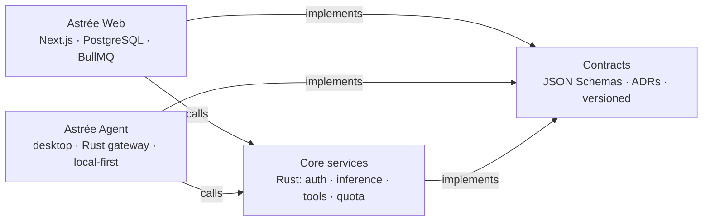

# Alexis Devos

**Product engineer building AI agents that hold up in production** — and the engineering system that lets a team of coding agents ship them safely.

Founder & CTO of [Astrée](https://astree.online), an AI product for law firms, in production. Based in Paris. **Open to a full-time role building and operating AI agents** (Paris or remote), as well as focused missions.

## At a glance

- **Astrée** — a web app in production and a desktop legal agent, built on a shared foundation of versioned contracts and Rust services.
- **~590 pull requests merged in two weeks** across five repositories, produced by parallel coding agents and gated by tests, model-routed code review and a merge train I designed.
- **Security by design** — the model proposes, a gateway decides; every external action needs an approval bound to that exact action.

## Astrée: one product, a shared foundation

- **Contracts first.** Every shared interface (identity, permissions, agent API, inference, tools, usage quota) is a versioned schema with test vectors, pinned by exact commit in each consumer. Architecture decisions are written as ADRs before code.
- **One implementation per capability.** Authentication, the inference facade, the tool platform and the per-account usage quota are being consolidated into Rust core services that both products consume, replacing logic that had grown twice — a migration planned dependency by dependency (contract, then core, then consumers).
- **The desktop agent** keeps client files on the lawyer's machine. A Rust gateway validates, persists and audits every step; an incoming email or document is data, never an instruction.
- **Shared usage quota** (in progress), like consumer AI products: one allowance per account across web and desktop, counted server-side, with a gauge for the user and an envelope the firm admin can split.

| Project | What it demonstrates |
| --- | --- |
| [Astrée](https://github.com/AlexisDevos/astree-case-study), in production | Gmail triage, Google Drive import (OAuth and push webhooks), deadline extraction to calendar, legal watch and a morning briefing, run as about twenty BullMQ job types. Prompt regression suites with promptfoo, including prompt injection through documents and citation grounding. Sentry with PII scrubbing, Prometheus metrics and logs shipped to Grafana |
| [Astrée Agent](https://github.com/AlexisDevos/astree-agent-case-study), in development | An always-on legal agent: Tauri desktop app over a Rust gateway (about 290,000 lines of Rust with tests, 45 ADRs). Approvals bound to the exact action, single-use and short-lived; tool calls offered from a closed catalog; evals on a synthetic law firm |

## Agent kit: a delivery system for coding agents

I run development as a pipeline of autonomous coding agents on dedicated servers, with the human setting direction and deciding what matters. The kit I wrote for it handles what makes this reliable rather than chaotic:

- **Backlog to merged PR** — lots are read from an approved backlog with their prerequisites (including across repositories), reserved, and built in isolated worktrees with their own databases.
- **Gates and review** — targeted tests during the day, the full suite at night; security-sensitive changes get a dedicated review by a stronger model, the rest a grouped review; only blocking findings are fixed in the loop, the rest go to a logbook.
- **Merge train** — re-verifies the exact merged tree before publishing, merges, closes the linked issues and cleans up the environment.
- **Unattended mode** — decisions are logged with their rollback; anything outside a lot's scope is parked for a human, never worked around; alerts cover stalled agents, pending decisions, the work window and quota.
- **Cost control** — usage measured per model and per lot, so routing (which model writes, which reviews) is a measured choice.
- **Audited like a product** — a full lifecycle audit found 46 gaps; each fix ships with tests and an independent review before reaching the servers.

## Open-source engineering

Work on other people's runtimes, where the bar is someone else's review:

- **[T3 Code #7331](https://github.com/pingdotgg/t3code/issues/7331)** — DeepSeek Harness provider integration: driver, adapter, JSON-RPC runtime, streaming, model discovery and headless generation.
- **[DeepSeek Harness #2888](https://github.com/deepseek-ai/deepseek-harness/discussions/2888)** — SDK wire lifecycle: `session/cancel` and `session/close`, 107/107 tests, lint and typecheck green.
- **[Command Code #371](https://github.com/CommandCodeAI/command-code/issues/371)** — Diagnosed an MCP process leak: orphaned Python processes accumulating across sessions to 60 processes and 1.52 GB, traced to `detached: true` + `.unref()`.

Also: [dsh-remote-vps](https://github.com/AlexisDevos/dsh-remote-vps) (Rust agent, SSH confinement, gRPC, systemd hardening) and a [VPS sandbox connector with 69/69 deterministic tests](https://github.com/AlexisDevos/grok-bot-0.18-reconstructed).

## Technical focus

`TypeScript` · `Rust` · `Python` · `Next.js` · `Tauri` · `PostgreSQL` · `Redis/BullMQ` · `LLM APIs` · `MCP` · `evals` · `multi-agent orchestration` · `contract-first architecture` · `security` · `observability`

## Contact

- Website: [astree.online](https://astree.online)
- LinkedIn: [alexis4astree](https://www.linkedin.com/in/alexis4astree/)

For a full-time role on AI agents, a product build or an architecture review, [send me a message](https://www.linkedin.com/in/alexis4astree/).
